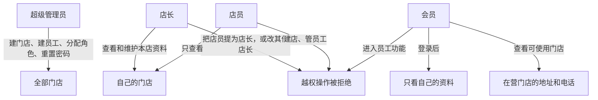

# M1 · 账号与门店 — 后端实现说明

> **协作：** 实现方为**后端开发（本助手）**，用 Cursor **云端写码（Cloud Agent）** 改仓；**不交给 Claude Code**。每阶段开 PR，链接交 **开发部 → 总经理 → 请坤总确认** 后再合入；**禁止**自行 merge / 部署 / 改生产。公开内容不得出现具体项目名；称呼**坤总**。  
> **日期：** 2026-10-27（Asia/Shanghai）  
> **仓库：** https://github.com/2770419748-lgtm/prepaid-member-miniprogram（空仓；等 M0 经坤总确认合入后在 `apps/api` 扩展）  
> **落点：** `apps/api`（NestJS + Prisma + PostgreSQL）  
> **预估：** 约 6 人天 · **依赖 M0**  
> **硬约束对齐：** `docs/tech/tech-final.md` · `docs/tasks/m0-kickoff.md`（定稿第 3.1 / 6–8 节）  
> **实现状态：** 已在合入 main 的 M0 上落地。门店增加了导航和营业时间字段，员工增加了网页后台密码字段，没有新增数据表。合入须技术部审阅且 CI 通过后，由总经理评估。

---

## 1. 目标与非目标

### 目标

1. 微信**测试号**手机号授权登录（会员端 + 店员端可分 AppId）  
2. 区分**会员**与**店员**身份；店员走 `Staff` + `StaffStoreRole`  
3. 落地组织域：`Org` / `Store` / `Staff` / `StaffStoreRole` 的管理 API  
4. 角色鉴权：`SUPER_ADMIN` | `STORE_MANAGER` | `STAFF`；门店数据隔离（操作记门店；余额公司通用留给 M2）  
5. JWT 签发 / 校验；守卫与角色装饰器可复用到后续模块

### 非目标

- 开卡、充值、扣款、流水（→ M2）  
- e签宝真实联调（→ M4）  
- 审计日志完整实现（→ P2；本里程碑可预留写点注释）  
- 正式 AppID / 生产部署 / 微信支付  
- 自行 merge / 部署 / 改生产（须坤总确认）

---

## 2. 前置依赖（M0）

等 M0 落地后在现有 schema 上扩展；若冲突以能支撑下列实体与开关为准。

M0 应已具备：

- [ ] monorepo：`apps/api`、`apps/admin-web`、`apps/member-mp`、`apps/staff-mp`  
- [ ] Prisma 十一类实体初稿（含 Org/Store/Staff/StaffStoreRole/Member）  
- [ ] `.env.example`：`DATABASE_URL`、`JWT_SECRET`、`WECHAT_*`、`ESIGN_PRODUCTION_ENABLED=false`  
- [ ] CI、`GET /health`、空模块边界 `AuthModule` / `OrgModule` 注释  
- [ ] seed：1 Org + 1 Store + 1 Staff（超管）可选

开工前：确认全栈 M0 PR **已经坤总确认合入**；本地 `prisma migrate` / `generate` 成功。

---

## 3. 数据模型要点（字段可微调，关系与枚举不可缺）

对齐 M0；下列为建议字段（**可调**已标）。

### Org

| 字段 | 类型建议 | 说明 |
| --- | --- | --- |
| id | cuid/uuid | PK |
| name | string | 公司名 |
| status | enum/string | ACTIVE / DISABLED（可调） |
| createdAt / updatedAt | timestamptz | |

### Store

| 字段 | 类型建议 | 说明 |
| --- | --- | --- |
| id | | PK |
| orgId | FK → Org | |
| name | string | |
| status | | ACTIVE / DISABLED（可调） |
| address | string? | 详细地址 |
| lat / lng | decimal? | 纬度 / 经度，约六位小数。接口字段名为 `lat`、`lng` |
| contactPhone | string? | 联系电话。接口字段名为 `phone` |
| businessHours | string? | 营业时间，原文 |
| createdAt / updatedAt | | |

### Staff

| 字段 | 类型建议 | 说明 |
| --- | --- | --- |
| id | | PK |
| orgId | FK → Org | |
| phone | string | 登录关联 |
| passwordHash | string? | 网页后台密码的 bcrypt 哈希。不明文保存，不返回给调用方 |
| mustChangePassword | boolean | 初始密码登录后必须修改 |
| failedLoginCount / lockedUntil | | 连续错 5 次锁定 15 分钟 |
| name | string | |
| status | | ACTIVE / DISABLED |
| wxOpenId | string? | 店员小程序 openid（可调） |
| createdAt / updatedAt | | |

建议：`@@unique([orgId, phone])`（可调，但需能按手机号找店员）。

### StaffStoreRole

| 字段 | 类型建议 | 说明 |
| --- | --- | --- |
| id | | PK |
| staffId | FK → Staff | |
| storeId | FK → Store | |
| role | enum | **`SUPER_ADMIN` \| `STORE_MANAGER` \| `STAFF`** |
| | | `@@unique([staffId, storeId])` |

> 超管可约定：绑定任意一店 + `SUPER_ADMIN`，鉴权时忽略 store 限制；或单独 org 级标记（实现二选一，文档写清）。

### Member（M1 登录会读写；开卡细节属 M2）

| 字段 | 类型建议 | 说明 |
| --- | --- | --- |
| id | | PK |
| orgId | FK | |
| phone | string | **必填**；`@@unique([orgId, phone])` |
| wxOpenId / wxUnionId | string? | 微信标识 |
| openStoreId | FK? → Store | 开卡门店（开卡时写，M2；登录可空） |
| status | | ACTIVE / DISABLED 等 |
| createdAt / updatedAt | | |

---

## 4. 权限矩阵

| 角色 | 门店范围 | 账号 | 本模块能力 |
| --- | --- | --- | --- |
| `SUPER_ADMIN` | 全部门店 | 全公司账号 | 门店 CRUD、店员分配任意店、查全部 |
| `STORE_MANAGER` | 本店 | 本店普通店员 | 可维护本店地址、坐标、电话、营业时间；只能管理普通店员，不能任命店长，也不能改自己或其他店长 |
| `STAFF` | 本店 | — | 只读本店信息（开卡/记账在 M2） |
| 会员端 | — | 仅自己 | 登录、读自己资料、读可使用门店；没有员工相关接口 |

- 店员操作一律带 `storeId`（后续账务记门店）。  
- 余额不按门店隔离（M2）；本模块只需保证角色守卫正确。

---

## 5. API 清单

> 路径前缀建议 `/api/v1`；最终以仓内全局前缀为准。金额本模块不涉及。

### 5.1 认证

| 方法 | 路径 | 鉴权 | 请求要点 | 响应要点 |
| --- | --- | --- | --- | --- |
| POST | `/auth/wx-phone` | 无 | `code`（wx.login）+ 手机号授权 `phoneCode`；小程序 `WECHAT_MEMBER_*`（会员和员工共用一个小程序，2026-11-04 起）。小程序登录页只调这一个 | 手机号是本公司在职员工：和 `/auth/staff/wx-phone` 一样的员工结果（`principalType: STAFF`），小程序进工作台；否则和 `/auth/member/wx-phone` 一样的会员结果（`principalType: MEMBER`）。员工停用后再登录就是会员。员工登录不顺手建会员 |
| POST | `/auth/member/wx-phone` | 无 | 同上。只按会员登录，脚本和测试用 | JWT + member 摘要；第一次登录只登记身份，不建余额。未开卡时 `needsCard` 为真。有效期 `MINIPROGRAM_JWT_EXPIRES_IN`（默认 30 天） |
| POST | `/auth/member/session/renew` | 会员 | — | 和上一行一样的结构，有效期从现在重新算。会员小程序每天打开时调一次。员工调 403；会员被停用后 401 |
| POST | `/auth/staff/wx-phone` | 无 | 同上。只按员工登录，手机号须已存在于 `Staff` 且在职，脚本和测试用 | JWT + staff + roles[]。有效期 `MINIPROGRAM_JWT_EXPIRES_IN`（默认 30 天） |
| POST | `/auth/staff/member-session` | 小程序登录的员工 | — | 工作台「切到我的会员卡」：员工本人手机号的会员登录（没有会员就建，没开卡），结构同会员登录。网页后台的密码登录、会员调 403；员工停用、改密、改手机号后 401 |
| POST | `/auth/staff/session/renew` | 员工小程序登录 | — | 和上一行一样的结构，有效期从现在重新算。员工小程序每天打开时调一次。密码登录（网页后台）、会员调 403；停用、改密、重置后 401 |
| POST | `/auth/staff/password/login` | 无 | 网页后台。`phone`、`password`，多家公司时带 `orgId` | JWT + `mustChangePassword`。连续错 5 次锁定 15 分钟。不返回密码 |
| POST | `/auth/staff/password/change` | 员工 | `currentPassword`、`newPassword` | 修改成功后 `mustChangePassword` 为假。这位员工之前的登录全部作废，要用新密码重新登录 |
| GET | `/auth/me` | 登录 | — | 当前身份：member 或 staff+roles。员工结果含 `mustChangePassword`；会员结果含 `workbench`（这个手机号是不是在职员工，小程序「我的」据此显示「进入工作台」） |

说明：测试号阶段按微信开放文档换 session / 手机号；密钥只读 env，不进仓。每个手机号凭证微信只认一次，所以小程序一次登录只调一次 `/auth/wx-phone`。超级管理员改员工手机号时这位员工的登录版本号加一，旧登录全部作废。

登录有效期（2026-11-01 坤总要求员工小程序和会员小程序都「一次登录以后就一直登录」）：两个小程序 30 天（`MINIPROGRAM_JWT_EXPIRES_IN`）并每天打开时自动续期，常用就不用重新登录；商家后台 12 小时（`JWT_EXPIRES_IN`），不续期。停用、改密、重置密码在每次请求时按数据库判断，马上失效。

### 5.2 门店（店员 JWT）

| 方法 | 路径 | 角色 | 说明 |
| --- | --- | --- | --- |
| GET | `/stores` | 超管：全部；店长/店员：本店列表 | 分页可选；按建店先后排（2026-11-07 起，和小程序会员看到的顺序一样） |
| POST | `/stores` | `SUPER_ADMIN` | 创建门店 |
| POST | `/stores/import` | `SUPER_ADMIN` | 用表格批量录门店，见第 11 节「批量导入门店」 |
| PATCH | `/stores/:id` | `SUPER_ADMIN`（店长改本店基础信息可调） | 更新 |
| GET | `/stores/:id` | 有权访问该店 | 详情 |

### 5.3 店员与角色

| 方法 | 路径 | 角色 | 说明 |
| --- | --- | --- | --- |
| GET | `/staff` | 超管全公司；店长本店 | 列表 |
| POST | `/staff` | 超管；店长可建本店 `STAFF`（可调） | body: phone, name, storeId, role |
| PATCH | `/staff/:id` | 超管 / 本店店长 | 停用、改名等 |
| PUT | `/staff/:id/roles` | 超管可设任意角色。店长只能动本店的普通店员、只能分配本店店员，不能改自己或其他店长 | 设置 `StaffStoreRole`；调店规则见下文「调店」 |
| POST | `/staff/:id/password/reset` | 仅超级管理员 | 重置网页后台初始密码，并要求下次登录修改。不接受短信验证码 |
| GET | `/staff/me/stores` | 任意店员 | 当前账号可操作门店 |

### 5.4 会员只读（可选本里程碑）

| 方法 | 路径 | 鉴权 | 说明 |
| --- | --- | --- | --- |
| GET | `/members/me` | 会员 JWT | 自己的资料（无余额，余额以 M2 为准） |
| GET | `/members/stores` | 会员 JWT | 在营门店的名称、详细地址、经纬度、电话、营业时间。不含员工信息。停用门店不返回 |

---

## 6. 业务规则与硬约束

1. **小程序登录 = 微信授权手机号**（测试号）。网页后台员工登录 = 手机号 + 密码，密码只存 bcrypt 哈希，不接短信。禁止伪造手机号后门进生产路径（本地 dev mock 须用独立开关且默认关；`NODE_ENV=production` 时强制关闭）。  
2. 店员登录：手机号必须已在 `Staff` 中；未录入店员不可登录后台或商家小程序。网页后台连续密码错误 5 次锁定 15 分钟。新建或重置的是初始密码，第一次登录必须修改（`mustChangePassword`）。  
3. 会员登录：可先建/更新 `Member` 的微信标识与手机号；**开卡状态 / 余额**由 M2 店员录入流程定义（本模块勿实现充值）。  
4. JWT 载荷建议：`sub`, `orgId`, `principalType: MEMBER|STAFF`, `roles?: {storeId, role}[]`。  
5. 数据隔离：非超管查询必须按 `storeId ∈ token.roles` 过滤。  
6. 密钥：`WECHAT_*`、`JWT_SECRET` 仅 env；公开文案无具体项目名。  
7. **禁止**引入微信支付 SDK。

---

## 7. 云端开 PR 验收清单

- [ ] 会员测试号手机号登录成功，返回 JWT；`GET /auth/me` 为会员  
- [ ] 店员测试号登录成功；未录入 Staff 的手机号被拒绝  
- [ ] seed 超管可创建门店、分配 `STORE_MANAGER` / `STAFF`  
- [ ] 店长只能看到/管理本店；跨店返回 403  
- [ ] 店员不能调用超管专属接口  
- [ ] 会员 JWT 访问店员 API 返回 403  
- [ ] 角色枚举值为 `SUPER_ADMIN` | `STORE_MANAGER` | `STAFF`（与 M0 一致）  
- [ ] 无真实密钥进仓；无微信支付依赖  
- [ ] 单测或 e2e：至少覆盖「角色守卫拒绝跨店」与「店员登录校验」  
- [ ] 已开 PR（建议 `feat/m1-auth-stores`），**未自行 merge**；PR 链接已交开发部请坤总确认

---

## 8. 测试建议

- 单元：JwtStrategy 载荷解析；RolesGuard 矩阵表驱动  
- 集成：Prisma + 测试库；创建 org/store/staff 后打登录与列表接口  
- Mock：微信 code2session / 手机号接口用 http mock，勿打真实网  
- 回归：改 schema 后 `prisma validate` + CI 绿

---

## 9. 后端直接实现步骤

1. 确认 M0 schema / env / 空 `AuthModule`/`OrgModule` 位置（M0 已合入）  
2. 补齐枚举与索引（若 M0 已齐则跳过）；`prisma migrate`  
3. 实现微信手机号换取服务（Member / Staff 两套 config）  
4. JWT 模块 + 登录两个 endpoint + `/auth/me`  
5. Guards：`JwtAuthGuard`、`RolesGuard`、可选 `@StoreScope()`  
6. Stores CRUD（按角色过滤）  
7. Staff + StaffStoreRole 管理 API  
8. 写单测；更新 `docs` 简短说明登录流（无具体项目名）  
9. 自检验收清单 → 用 Cloud Agent 开 PR → **PR 链接交开发部，等坤总确认后再合入**（禁止自行 merge / 部署）

---

## 10. 合入须坤总确认

实现与自测通过后：列出变更文件与验收勾选结果，开 PR（如 `feat/m1-auth-stores`），**不要 force-push / 自行合 main / 部署**。将 PR 链接交开发部，由开发部转总经理请**坤总确认**后再合入。

---

## 11. 实现口径（已落地）

接口没有 `/api/v1` 前缀，和现有的 `GET /health` 放在一起。说明页在 `GET /docs`。

### 登录

小程序用微信手机号登录，两套测试号配置分开（`WECHAT_MEMBER_*` 与 `WECHAT_STAFF_*`）。网页后台的员工登录用手机号和密码，不使用短信验证码。

- 员工必须事先录入且为在职，否则小程序登录拒绝。网页后台密码错误时只回答「手机号或密码错误」，不透露账号是否存在。
- 新建员工时设置初始密码，只保存 bcrypt 哈希。第一次用初始密码登录网页后台时，结果里 `mustChangePassword` 为真，员工要调用修改密码接口换成自己的密码。超级管理员可以重置密码，重置后再次要求修改。
- 服务端强制（2026-10-28）：用密码登录、还没改密时，除 `GET /auth/me` 和修改密码外的接口都返回 403 `code: MUST_CHANGE_PASSWORD`。改密或被重置后之前的登录全部作废。员工小程序（微信手机号登录）不受这条限制。详见 [security-hardening.md](./security-hardening.md)。
- 同一账号连续输错 5 次后锁定 15 分钟。锁定期间即使密码正确也不能登录。锁定结束后重新计数。
- 会员第一次登录会登记手机号和微信标识，不建余额、不开卡。还没有开卡门店时，结果里 `needsCard` 为真。
- 只有一家在营公司时可以不填公司；有多家时必须指定。
- 本地可以用假手机号演示小程序登录，开关是 `WECHAT_PHONE_MOCK`，默认关闭。`NODE_ENV=production` 时即使写成 true 也不生效。服务启动时如果假手机号开着，会打出警告。

超级管理员只要在任意一家门店拥有该角色，就可以管全公司。店和店之间没有上下级。店长只能管理本店的普通店员。

### 权限



高级角色包含低级角色能做的事：超级管理员 > 店长 > 店员。门店范围仍然隔离，只有超级管理员不受门店限制。

店长可以改自己店的名称、详细地址、经纬度、电话和营业时间，不能改营业状态，不能新建门店。店长只能在本店新建普通店员，只能把普通店员继续设成店员；不能把店员提为店长，不能修改自己的角色，也不能撤销或修改其他店长。店员只能看自己的店。会员没有员工接口，只能看自己的资料（没有余额）和在营门店列表。门店列表给出名称、详细地址、经纬度、电话和营业时间，供一键导航和拨号。停用的门店不出现。

### 调店（换门店）

没有单独的「调店」按钮。每位员工挂着「哪家店 + 什么角色」，一个人可以同时在几家店。调店就是改 `PUT /staff/:id/roles`（后台「员工管理 → 门店角色」）。2026-11-07 坤总确认的规则：

- **谁能调：** 只有超级管理员能把人调去别的门店，店员、店长都能调，也能升降角色。店长只能在自己管的店里加或移除普通店员：目标员工必须已经在店长管的某家店里（否则 403「这位员工不在你管的门店，调店请找超级管理员」），只能分配本店的店员角色，不能动店长和自己。员工都不能给自己调店。小程序工作台的「切换门店」只是在已分配的门店之间选当前门店，不是调店。
- **马上生效：** 每次请求都按数据库重新算角色，不用重新登录。工作台首页、「我的」会刷新门店列表，旧店消失就自动换到剩下的第一家。
- **历史：** 流水永远记在发生的门店，操作人不变，原店的对账不变。调走的人看不到原店流水，原店的账也冲正不了（403），由原店现任店长或超管处理。本人做过的事在操作记录里仍可见。
- **一家门店都不剩自动停用：** 改完角色后员工一家门店都没有了，账号同时停用（旧登录立即失效，再登录小程序就是会员）。已停用且没有门店的员工不能直接恢复（400「请先在「门店角色」里分配门店再恢复」）；先分配门店，再恢复。分配门店本身不会自动恢复。
- **至少留一位在职超级管理员：** 降级、移除全部门店或停用的对象原来是在职超级管理员时，改完公司里必须还有一位在职超级管理员，否则整笔撤回（409「公司至少要留一位在职的超级管理员」）。角色和停用的修改在公司这一行上排队（`FOR NO KEY UPDATE`，不挡记账），两位超管同时互相降级只有一位能成。
- **留痕：** `STAFF_ROLES_REPLACE` 记 `previousRoles` 和 `roles`（都是完整的门店角色，带 `storeName`），移空时加 `autoDisabled: true`；`relatedStoreIds` 记调出、调入的门店，这些门店的店长在操作记录里都看得到这次调动。`STAFF_UPDATE`（改名、停用、恢复、换手机号）的 `relatedStoreIds` 是这位员工当时所在的门店。

### 批量导入门店（2026-11-07）

坤总问「现在都是演示的门店，我怎么添加公司真实的门店名称、地址和联系方式」。约 20 家店一家家填太慢，后台「门店管理」加了「下载门店表格」和「批量导入」，只给超级管理员。

- **表格：** 一行一家店，列是「门店名称、详细地址、联系电话、营业时间、坐标」。名称必填（≤80 字），地址 ≤200、电话 ≤30、营业时间 ≤200。坐标一格写两个数，腾讯坐标拾取器给的「纬度,经度」和高德给的「经度,纬度」都认（国内纬度 3～54、经度 73～136 不重叠），也认分开的「纬度」「经度」两列。腾讯、高德和微信 `wx.getLocation`/`wx.openLocation` 都是 GCJ-02；百度是 BD-09，会偏几百米，表格说明里写了别用。下载的表格把现有门店（含已停用的）按建店先后列上，第二张表是填写说明；整列设成文本，免得手机号变成 1.38E+10、营业时间变成小数。
- **读文件在浏览器里：** `.xlsx`（`apps/admin-web/src/utils/xlsx.ts`，fflate 解压后按 OOXML 取文字，Excel、WPS 存的都认，优先读「门店清单」那张）和 `.csv`（UTF-8 或 Excel 另存的 GBK）。旧版 `.xls` 提示另存。格式不对的行（没名称、重名、坐标看不懂、营业时间被存成时间数字）在前端就列出行号，一家都不导。
- **接口：** `POST /stores/import { dryRun, rows: [{ name, address?, phone?, businessHours?, lat?, lng? }] }`，最多 200 行。按名称（去首尾空格）对上已有门店：只改填了且和后台不一样的项，空格子不动，不改营业状态（对上已停用的门店照样改资料）；对不上的新建为营业中。返回每行 `action`（`CREATE` / `UPDATE` / `UNCHANGED` / `ERROR`）、对上的 `storeId`、`storeDisabled`、会改的项 `changes`（`address` / `phone` / `businessHours` / `location`）和 `error`。`dryRun: true` 只核对，前端拿它做「导入前预览」；`dryRun: false` 在一个事务里先锁公司这一行（`FOR NO KEY UPDATE`，两人同时导入排队，不挡记账），对着最新数据再算一遍，有一行 `ERROR`（表里重名、后台有两家同名、只填了纬度或经度）就整批不导（400「表格里有 N 行要先改好，这次一家都没导入」）。
- **改名、清空某一项、停用** 不走导入，在页面上点那家店的「编辑」「停用」。
- **留痕：** 每家新建或改动的门店各写一条 `STORE_CREATE` / `STORE_UPDATE`，`payload.source = 'import'`，后台操作记录显示「用表格批量导入」。没变化的不写。
- **上线当天的用法：** `prepaid.sh init-company` 只建第一家店（只有名字）。登录后台 → 门店管理 → 批量导入填好的表，第一家店同名会补全资料，其余新建。

### 会留下记录的操作

创建门店、修改门店、创建员工、修改员工、重设门店角色、员工自己修改密码、超级管理员重置密码、会员第一次登记。不提供查询接口，查询留给后续审计。记录里不写密钥，也不写密码。

### 怎么自己再跑一遍

数据库迁移后启动服务（演示时把 `WECHAT_PHONE_MOCK` 设为 true，正式环境不要设）。本地种子账号 `13800000000` 的初始密码是 `Init12345`，第一次网页登录必须修改：

```bash
pnpm --filter api prisma:migrate
pnpm --filter api start:dev
pnpm --filter api exec tsx scripts/m1-acceptance-demo.ts
```

自动测试：`pnpm --filter api test` 跑单元测试。设置 `RUN_DB_TESTS=1` 且数据库已迁移时，会再跑登录和越权的集成测试。CI 会起临时数据库并跑这两部分。
